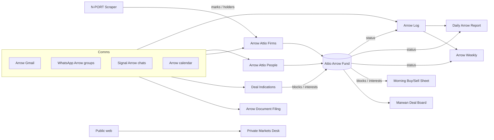

# Arrow bots

Index of Grok Bots that serve Arrow Fund only. Each entry lives in `arrow/bots/<slug>.md`. Arrow content stays in `arrow/`; personal, Delta and Janey bots are indexed in [`bots/MAP.md`](../bots/MAP.md).

**How to update:** the bot that owns an entry updates `arrow/bots/<slug>.md` and this index in the same commit whenever it is created, renamed, deleted, or its description, routines, cadence or send permissions change. Grok Bot runs "Bot registry refresh" daily at 7pm PT and flags drift. See `AGENTS.md`.

Template: [`arrow/bots/_TEMPLATE.md`](_TEMPLATE.md).

## Registry

| Bot | Slug / file | Skill | Status in registry |
|---|---|---|---|
| Morning Buy/Sell Sheet | [morning-buy-sell-sheet](bots/morning-buy-sell-sheet.md) | `arrow/skills/morning-buy-sell-sheet` | self-reported 2026-11-05 · live (Signal; Gabe/WhatsApp switch pending) |
| N-PORT Scraper | [nport-scraper](bots/nport-scraper.md) | `arrow/skills/nport-scraper` | pending self-report |
| Private Markets Desk | [private-markets-desk](bots/private-markets-desk.md) | `arrow/skills/private-markets-desk` | self-reported 2026-11-05 · live |
| Arrow Weekly | [arrow-weekly](bots/arrow-weekly.md) | `arrow/skills/arrow-weekly` | self-reported 2026-11-05 · test (no routine; first send pending) |
| Arrow Document Filing Bot | [arrow-document-filing](bots/arrow-document-filing.md) | `arrow/skills/arrow-fund-inbox` (+ `document-filing`) | self-reported 2026-11-05 · live; Arrow-facing only, private cross-silo registry relocation pending |
| Arrow Attio Firms | [arrow-attio-firms](bots/arrow-attio-firms.md) | `arrow/skills/arrow-attio-firm-context` | self-reported 2026-11-05 · live (PROPOSE; 1 enabled routine; writes require approval) |
| Deal Indications Bot | [deal-indications](bots/deal-indications.md) | `arrow/skills/deal-indications` | self-reported 2026-11-05 · live |
| Marwan Deal Board Bot | [marwan-deal-board](bots/marwan-deal-board.md) | (none in repo yet; logic in routine prompts) | self-reported 2026-11-05 · live (2 routines) |
| Arrow Attio People | [arrow-attio-people](bots/arrow-attio-people.md) | `arrow/skills/attio-contact-context` | self-reported 2026-11-05 · live |
| Daily Arrow Report | [daily-arrow-report](bots/daily-arrow-report.md) | `arrow/skills/daily-arrow-report` | self-reported 2026-11-05 · test (no routine; first send pending) |
| Arrow Log | [arrow-log](bots/arrow-log.md) | `arrow/skills/arrow-weekly-log` | self-reported 2026-11-05 · live (routines "Arrow weekly log" + "Arrow log Friday wrap") |

## Data flow (from INDEX.md and skills)

Cross-silo bots that only *mention* Arrow (CoS, Grok Bot, etc.) live under [`bots/MAP.md`](../bots/MAP.md) and point here for Arrow detail.
